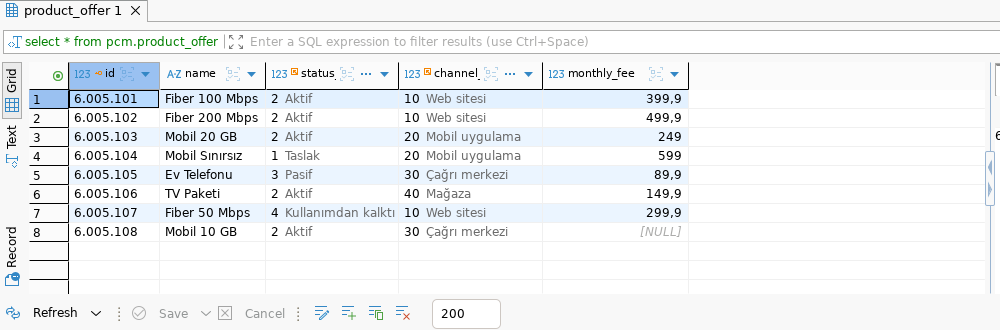
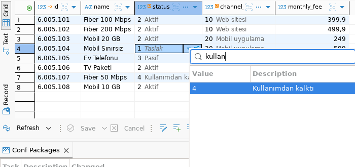
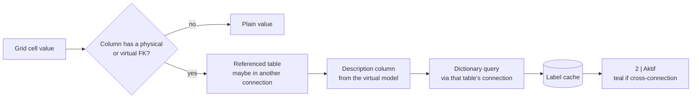

# dbeaver-mm

🇹🇷 **[Türkçe dokümantasyon → README.tr.md](README.tr.md)**


> **dbeaver-mm: see what every ID means, and pick values instead of typing them.**

---

## 📖 How it works: user guide

The meaning of an ID shows up next to the ID, and wherever a value has to be written you search it by name and pick it:





Step-by-step guide with screenshots for every feature (Turkish): **[Kullanım Rehberi → docs/KULLANIM.md](docs/KULLANIM.md)**

## 📌 About the Project and Problem Statement

In a normalized database most columns hold IDs: `order_type_id = 2`, `service_id = 14`. To find out what an ID means,
an analyst has to write a join or open the dictionary table in another tab. To filter or query by a value, they look
the ID up somewhere else and type it in by hand. It gets worse when the data is spread over several connections, for
example test data in one database and configuration in another. Stock DBeaver can show a referenced value only
through separate editors, and its SQL editor is bound to one connection at a time.

dbeaver-mm is a fork of [DBeaver Community](https://github.com/dbeaver/dbeaver) that shows the meaning of an ID where
the ID appears (grid, filter box, SQL editor) and opens a searchable picker wherever an ID has to be written. It also
works across connections. Everything runs on the client side on top of DBeaver's own model: physical foreign keys,
virtual foreign keys and the virtual model's description column. It needs no server component, no PRO features and
no separate rule engine, so it stays a thin layer over upstream DBeaver.

## ✨ Key Features

* **FK dictionary labels in the grid:** A foreign key cell shows the referenced description next to the ID
  (`2 | Aktif`). A header button chooses the label column and the choice is saved in the virtual model. Labels
  reached through a virtual FK into *another connection* are painted teal.
* **Value pickers everywhere:** A searchable Value / Description popup is available in dictionary FK cells, empty
  (`[NULL]`) ones included. Typing `column =` in the result filter box or `fk_column =` / `column IN (` in the SQL
  editor opens a list of values with their labels. Searches run in the database and ignore case and accents
  (`müşteri` finds `Musteri`).
* **Multi-connection SQL editor:** A connections bar chooses which connections a script may use. The editor switches
  to the connection that holds the statement's tables. Table names are completed across connections
  (`Table | Connection`), and connection short codes (`<code>.`) narrow the list to a single connection.
* **Script tools:** A Recent SQL Scripts panel shows the last 10 scripts as cards with their WHERE conditions, with
  favorites pinned on top. A parameter form (`Ctrl+Alt+P`) edits every `column = value` condition of a script in one
  place.
* **IDs for new rows:** *Edit › Fetch IDs for new rows* asks the id API for as many ids as there are new rows
  with an empty key and writes them into the grid without saving. The
  domain is chosen once per connection.
* **Conf packages:** *Edit › Add changes to conf package ...* turns the grid's unsaved changes into SQL (the same
  script as *Generate SQL*) and appends it to `Scripts/conf/<task id>.sql`, whose first line is the task
  description. The grid changes can be discarded right away, so the tab closes without saving to the database.
  The in-cell FK picker lists rows that exist only in conf packages first, marked `[conf <task id>]`.
  *Window › Conf Packages* opens a bottom panel: packages newest first, the selected one's INSERTs as a row
  grid per table and its whole SQL on a second tab. It refreshes itself when a package changes. FK columns show
  `value | label` like the grid; right click or Ctrl+C copies a cell's value, *Copy row* the whole row.
  A row's FK value and the row it references in the same package share a background color. Right click ›
  *Delete row ...* opens a table of the row, the rows below it (checked down to the chosen level) and the rows above
  it (unchecked); while it is open the panel shows rows to delete in red, rows left pointing at them amber. With
  several schemas the panel separates them with a line and a title (e.g. *PCM confs*). Copy buttons put the package's script on the clipboard,
  one per schema it writes to (e.g. *Copy pcm*, *Copy domain_config*) plus *Copy all*, without the description line.
  Copied scripts run without FK errors: DELETEs child tables first, INSERTs parent rows first, then UPDATEs.
* **Easier reading:** Group rows by a column in two alternating colors. The navigator shows tables directly and puts
  views, indexes and other objects into one *Other objects* node.
* **Freeze recorder:** When the window stops responding for a second or more, how long and where it hung is written to `~/.dbeaver-mm/donma.log`; freezes of 2 s or more also show a notification afterwards (off in *Preferences › User Interface › Notifications › UI freeze*). A small *Working: …* label in the bottom-right corner shows a background job that has run for over a second, so waiting is no longer mistaken for a freeze. *Plus › Create Problem Report* zips version info, the freeze log and the error logs of the last sessions onto the desktop, to send to whoever looks into the problem; nothing is sent automatically. The debug log shows aliases instead of secrets (`connection#1`, `host#1`, `user#1`, `db#1`, `ip#1`; passwords `***`), and no longer lists every plug-in start (`> Start`). The Eclipse error log messages and session records use the same aliases, and the problem report masks every file before zipping it.
* **Session recording:** Table opens, searches/filters in a table, DML/DDL, conf package changes and fetched IDs are logged to `~/.dbeaver-mm/kayit/surekli.jsonl` (rotated at 2 MB). *Plus › Start session...* asks for a name and records every step (commands, tabs, navigator, Ctrl+F, SQL) to its own file until stopped; a red *REC* label shows while it runs. Writing happens on a background thread, never on the UI thread, and nothing is sent anywhere. Only with consent and under a nickname: asked on first start, changed under *Plus Settings › Automatic recording...*. Connection names, hosts, users and passwords in records are replaced by aliases (`connection#1`, `***`).
* **Undo script:** After each Save in a table grid, an SQL script that reverses it (re-inserts deleted rows, writes back old values, removes inserted rows) is kept in `~/.dbeaver-mm/geri-al/` for 30 days, independent of session-recording consent and never sent anywhere. A notification appears; clicking it opens the script in the SQL editor to review and run. *Plus › Change history...* lists past scripts with a preview, opens or copies them, and turns the feature off. Rows deleted by cascade and LOB values are not in the script (a warning line says so).

## 🛠 Tech Stack

* **Language / platform:** Java 21 (`JavaSE-21`), Eclipse RCP / OSGi bundles
* **UI:** SWT and JFace; the data grid is DBeaver's `LightGrid` (`SpreadsheetPresentation`); SQL editing uses the
  Eclipse text framework
* **Data access:** JDBC through DBeaver's model (`DBSEntityAssociation`, virtual model `DBVEntity`, dictionary queries)
* **Build:** Apache Maven + Eclipse Tycho; OSGi dependencies come from Eclipse P2 repositories
* **Base:** DBeaver Community (`devel`), plus the repositories listed in `project.deps` (`dbeaver-common`,
  `datadam-api`)
* **AI / ML:** None in the fork's features (upstream DBeaver's own AI features are unchanged)

## 🏗 System Architecture and How It Works

The fork changes a few upstream bundles and adds two of its own:

| Bundle | Role in the fork |
|---|---|
| `org.jkiss.dbeaver.ui.editors.data` | Grid FK labels, header label button, in-cell picker, filter box values, row grouping |
| `org.jkiss.dbeaver.ui.inlinefkpicker` (new) | SQL FK picker, connections bar logic, auto connection, table completion, short codes, parameter form |
| `org.jkiss.dbeaver.ui.recentscripts` (new) | Recent SQL Scripts panel |
| `org.jkiss.dbeaver.ui.editors.sql` | Connections bar on top of the SQL editor |
| `org.jkiss.dbeaver.ui.navigator` | *Other objects* node |

Fork changes inside upstream code are marked with `// dbeaver-mm` comments.

Flow of an FK label, from a cell to the screen:



The pickers reuse the same path. The filter box, the in-cell popup and the SQL picker all ask for "values of the
referenced table with labels, matching this text" through one shared helper (`FkDictionaryLabels`). The search runs as
a database query on the right connection, and its results are folded for case and accents. In the SQL editor, the
caret analyzer (`SqlCaretAnalyzer`) reads the statement's `FROM` list and aliases to find the column's table. The
connection selector then looks for that table among the candidate connections, reading only their cached table lists
and never their data.

A missing label is never cached: if metadata is not loaded yet the cell shows the plain value, and the label appears
once metadata arrives.

## 🚀 Quick Start

**Windows, no build:** download `dbeaver-mm-windows-x64.zip` from [Releases](https://github.com/miracmenekse/dbeaver-mm/releases), unzip it and double-click `dbeaver\dbeaver.exe`. Java is bundled. If SmartScreen warns, choose *More info → Run anyway*.

**Building from source:**

**Prerequisites:** JDK 21, Apache Maven 3.9+, Git, about 4 GB of free disk space. Close any running DBeaver before you
build.

```bash
# All repositories must sit in the same parent folder
mkdir -p ~/dbeaver-dev && cd ~/dbeaver-dev
git clone https://github.com/dbeaver/dbeaver-common.git
git clone https://github.com/dbeaver/datadam-api.git
git clone https://github.com/miracmenekse/dbeaver-mm.git

# Full product build (Community edition)
cd dbeaver-mm
mvn package -f product/aggregate/pom.xml -T1C -Pproduct-dbeaver-ce

# The built product (one folder per platform) is under:
ls product/community/target/products/
```

No environment variables are required. On Linux with a dark GTK theme, start with `GTK_THEME=Adwaita:light` if the
grid looks wrong.

**Demo data:** The repository root has two SQLite scripts. Run them in DBeaver with `Alt+X`, then press `F5` on the
connection.
- `bsn_flow_spec_setup.sql`: a table with FKs to three dictionary tables.
- `cross_connection_fk_setup.sql`: data for a second connection, to try cross-connection virtual FKs.

## 💡 Usage & Examples

**1. Reading a result grid** (demo data from `bsn_flow_spec_setup.sql`)

```sql
SELECT id, label, status_id, priority_id FROM bsn_flow_spec;
```
```text
id  | label  | status_id      | priority_id
----+--------+----------------+-------------
100 | akis A | 2 | Aktif      | 3 | Yuksek
101 | akis B | 1 | Yeni       | 1 | Dusuk
102 | akis C | 3 | Tamamlandi | 2 | Orta
```

**2. Filtering by a label instead of an ID**

```text
Filter box input:   status_id = tamam
Proposals:          3 | Tamamlandi
After picking:      status_id = 3
```

**3. Writing SQL across connections** (demo data from `cross_connection_fk_setup.sql`;
`cfg` is the short code given to the `mm_config_db` connection)

```text
You type:           select * from cfg.serv
Proposals:          service_spec | mm_config_db
After picking:      select * from service_spec      (editor switched to mm_config_db)

You type:           select * from bsn_flow_spec where service_id =
Proposals:          10 | Faturalama
                    20 | Musteri Yonetimi
                    30 | Siparis Yonetimi
After picking:      ... where service_id = 20       (labels read from mm_config_db)
```

## 🗺 Roadmap

- [x] v0.1: FK dictionary labels, Recent SQL Scripts panel, inline FK picker, parameter form
- [x] Cross-connection FK labels and pickers (K1–K14)
- [x] Database-side, accent-blind value search in the filter box (K15–K20)
- [ ] Independent label column per FK column (today the choice is shared per referenced table)
- [ ] Value picker for `INSERT` / `UPDATE ... SET` positions
- [ ] Screenshots and a short demo video
- [ ] Prebuilt releases

## 📄 License & Contributing

dbeaver-mm is licensed under the [Apache License 2.0](LICENSE.md), like DBeaver Community. Every Java file starts with
the Apache 2.0 header in `docs/license_header.txt`.

Issues and pull requests are welcome. Please:
- Mark fork changes in upstream files with a `// dbeaver-mm` comment.
- Build on DBeaver's existing model (FKs, virtual model) instead of adding parallel mechanisms.
- Number commits `K<n>: <what changed>` and add a row to the development history below.

For upstream DBeaver documentation, drivers and downloads, see [dbeaver/dbeaver](https://github.com/dbeaver/dbeaver).

---

## dbeaver-mm development history

Each step of the fork, oldest first, so you can follow how the product grew. Items are numbered `K<n>` in commit messages.

| Step | Date | Change |
|---|---|---|
| [PR #1](https://github.com/miracmenekse/dbeaver-mm/pull/1) v0.1 | 2026-08-15 | First release. **FK dictionary labels** in the grid (`2 \| MAIN_ORDER`) with a header button that chooses the label column. New **Recent SQL Scripts** panel with favorites. New **inline FK picker** after `=` / `IN (` in the SQL editor, plus the **script parameter form** (`Ctrl+Alt+P`). |
| K1–K2 | 2026-09-19 | FK labels resolved through **cross-connection virtual FKs** (painted teal). `column =` in the result filter box lists dictionary values with labels. The SQL picker can choose its label column, shared with the grid. |
| K3–K6 | 2026-09-19 | **Group rows by column** in two alternating colors. **Simpler navigator** with an *Other objects* node. **In-cell FK dropdown** writes the picked value as an edit. The SQL editor **picks the connection automatically** from the statement's tables. |
| K7–K10 | 2026-09-20 | The filter box lists values of plain columns too. The cell picker becomes a **searchable popup**. **Column completion after WHERE / AND / OR** across connections. New **connections bar** on top of the SQL editor. |
| K11 | 2026-09-20 | **Table name completion across connections** after `from` / `join` / `into` / `update`. Accepting a table switches the connection. |
| K12–K13 | 2026-09-20 | **Accent- and case-blind search** (Turkish letters folded). No duplicated label when a column is its own label. **Connection short codes** (`<code>.` lists only that connection's tables). |
| K14 | 2026-09-22 | The SQL FK picker follows the real or virtual FK into another connection. The cell picker stays on screen near the bottom edge. |
| K15 | 2026-09-28 | A value picked in the filter box replaces the typed search text. |
| K16 | 2026-09-28 | The filter box value search runs **in the database**, not only in the first 50 rows. |
| K17 | 2026-09-28 | No `[NULL]` in dictionary labels. Accent-blind dictionary search is done in the database. |
| K18 | 2026-09-28 | Value search keeps going after a space inside an open quote. |
| K19 | 2026-09-28 | The connections bar shows each connection's short code. |
| K20 | 2026-09-30 | Option to list **only the values present in the result** in the filter box, labels included. |
| K23 | 2026-10-07 | The in-cell FK dropdown works on **empty (`[NULL]`) cells** too, so a missing value can be picked from the referenced table instead of showing *Can't navigate to NULL value*. |
| K24 | 2026-10-08 | *Fetch IDs for new rows* fills the key of the grid's new rows from the id API; the id domain is asked once per connection. |
| K25 | 2026-10-08 | *Add changes to conf package ...* appends the grid's unsaved changes as SQL to `Scripts/conf/<task id>.sql` and can discard them from the grid. |
| K26 | 2026-10-08 | The in-cell FK picker shows rows inserted in conf packages first, so a new parent row can be picked before it is in the database. |
| K27 | 2026-10-10 | *Conf Packages* bottom panel lists the packages and shows the selected one's inserted rows per table and its SQL; it refreshes as packages change. |
| K28 | 2026-10-10 | Conf Packages panel shows FK labels next to values (physical or virtual FK, also rows only in packages) and copies a cell or row with right click / Ctrl+C. |
| K29 | 2026-10-10 | Conf Packages panel colors related rows: an FK value and the referenced key in the same package share one color per relation. |
| K30 | 2026-10-10 | *Delete row ...* in the Conf Packages panel removes a row from the package alone or with its dependent rows down to a chosen level, and warns about rows left referencing it. |
| K31 | 2026-10-10 | Conf Packages panel copy buttons: the whole script or the statements of one schema (pcm, domain_config, ...), since each schema is sent separately. |
| K32 | 2026-10-10 | Copied conf scripts are in FK-safe order: DELETEs child tables first, INSERTs referenced rows first (also within one table), then the rest; the schema with parent rows comes first. |
| K33 | 2026-10-10 | Deleting from a conf package happens in the panel instead of a dialog: rows to delete are painted red, rows left behind amber, the level is picked in a bar above the rows. |
| K34 | 2026-10-10 | Delete is a light table dialog again and also lists the rows above (unchecked); the conf package dialog offers the 2 most recent task ids as buttons; the panel separates schemas with a line and title. |
| K35 | 2026-10-10 | Conf Packages panel keeps one row selection: clicking a row in one table clears the selection in the others. |
| K36 | 2026-10-10 | Double click a cell in the Conf Packages panel to edit it in place; Enter writes the value into the package's INSERT (`NULL` for null), Esc cancels. |
| K37 | 2026-10-10 | **Plus** main menu (between Window and Help) with Conf Packages, Recent SQL Scripts and Focus Mode; *Fetch IDs* and *Add to conf package* buttons next to the table editor's Properties / Data / Diagram tabs. |
| K38 | 2026-10-12 | **Windows download**: every `v*` tag builds a ready-to-run Windows zip with bundled Java on GitHub Releases. |
| K39 | 2026-10-12 | **Fetch IDs on Windows** with each user's own login. |
| K40 | 2026-10-12 | **Fetch IDs without scripts**: DBeaver calls the ID API itself, no bash or PowerShell needed. Replaces K39. |
| K41 | 2026-10-12 | First Windows download released: [v0.2.3](https://github.com/miracmenekse/dbeaver-mm/releases/tag/v0.2.3) (release build packs the product folder and pins sibling repos to the fork's upstream base). |
| K43 | 2026-10-12 | **Freeze recorder**: UI freezes of 1 s or more are logged with their cause to `~/.dbeaver-mm/donma.log`, 2 s or more also notify; a *Working: …* label shows slow background jobs. Freeze test setup in `test/perf/` (1 GB PostgreSQL test data, SSH-like latency proxy, JFR summary, report `RAPOR.md`). |
| K44 | 2026-10-12 | **No more grid freezes from FK labels over slow connections**: labels missing at paint time (e.g. orphan FK values) are no longer queried per cell on the UI thread but fetched together in the background, and "no label" is remembered. Over a 30 ms link, hovering a table with orphan values went from 4.2 s of UI waiting to 0. |
| K45 | 2026-10-12 | **Problem report**: *Plus › Create Problem Report* puts a zip with version info, freeze log and error logs on the desktop to send along with a bug report. |
| K46 | 2026-10-12 | **Conf Packages finds tables in every schema**: a package's tables were looked up only in the connection's default schema, so packages for other schemas (e.g. `pcm` with default `public`) got no FK labels or colors and were copied in file order instead of FK-safe order. Now the INSERT's own schema is used, and unqualified tables are searched in all schemas. |
| K47 | 2026-10-12 | **Session recording**: always-on light log of table opens, searches, DML and conf package changes, plus named sessions (*Plus › Start session...*) that record every step, to learn which configuration steps each kind of work needs. Measured: 0 file writes on the UI thread. |
| K48 | 2026-10-13 | **User guide** `docs/KULLANIM.md` (Turkish): every feature step by step with 17 screenshots; *How it works* section at the top of the README. |
| K49 | 2026-10-13 | **Recording only with consent, anonymous**: on first start dbeaver-mm explains why it records (to collect data so these systems can be run by automation later) and asks for a nickname (one of 20 Fellowship of the Ring characters or your own). Nothing is recorded without a yes; records carry only the nickname. *Plus Settings › Automatic recording...* turns it on or off and changes the nickname. |
| K50 | 2026-10-13 | **Session export**: stopping a session offers to zip its log, plus the conf package of the same name (`conf/<task>.sql`), onto the desktop to send on. Written off the UI thread. |
| K51 | 2026-10-13 | **Session analysis**: `tools/session-analysis/analiz.py` (stdlib) reads session logs or K50 zips and prints each session's steps per nickname and the steps most sessions share, as a process skeleton. |
| K52 | 2026-10-13 | **ID API account form**: user name and password are entered in a window instead of a hand-edited file. |
| K53 | 2026-10-13 | **Plus Settings menu**: a second top-level menu holds every Plus setting (ID API account, automatic recording, freeze notifications); *Plus* keeps only the features. Fetch IDs is set up with a file handed out separately; users only type their user name and password. |
| K56 | 2026-10-14 | Fetch IDs skips headers Java's HTTP client sets itself (`Connection`, `Host`, ...), so browser-copied headers in `id-api.properties` no longer fail. |
| K57 | 2026-10-14 | **Safer persist prompt**: closing an object editor with unsaved changes shows "Write to database?" with connection (red when the connection type confirms data changes), object and changes, plus an info note about the conf package. Default button is *Keep editing*; *Write to DB* stays disabled until the object name is typed. |
| K58 | 2026-10-15 | Fetch IDs no longer fails with "Range [13, 11) out of bounds" when `id-api.properties` has a short key such as `token.field`; header keys are checked for their prefix before it is cut off. |
| K61 | 2026-10-19 | The value picker of the filter popup now searches case-insensitively by default (the "case insensitive" option was off until toggled), so typing `b2b` finds `B2B`. |
| K62 | 2026-10-19 | The `column =` value proposals search the key column itself as well as its description column, so typing `b2b` after `shrt_code =` lists every `shrt_code` containing it (it only searched the description column, e.g. `cuser_name`). |
| K67 | 2026-10-22 | Conf packages: tables that are only DELETEd (no INSERT) now also contribute their FKs, so their DELETEs are ordered child-first too. |
| K68 | 2026-10-23 | Groundwork for `data_tp` / `row_id` labels: the column pair is recognised and the table → connection mapping is kept in `~/.dbeaver-mm/data-tp.properties` (no visible change yet). |
| K69 | 2026-10-23 | `data_tp` cells show the target table name from `etiya_type_value` next to the id (`14 \| CUST_CONTR`), read once per connection, in the same dimmed style as FK labels. |
| K70 | 2026-10-23 | `row_id` cells show the description of the row they point to: `data_tp` gives the table, the table is found among open connections (mapped automatically when only one has it and remembered), the label comes from its key column, and labels from another connection use the external-data colour. |
| K71 | 2026-10-23 | The `…` button on a `row_id` column header opens one window for all target tables of the result: pick the connection of a table that is not mapped yet, choose one or more label columns per table, see a live preview; labels refresh without re-running the query. |
| K72 | 2026-10-23 | Groundwork for per-tenant `data_tp` mapping: tenant = first word of the connection name, mapping kept in `~/.dbeaver-mm/data-tp/<TENANT>.properties` (no visible change yet). |
| K73 | 2026-10-23 | **Plus Settings › data_tp mapping...**: per tenant, pick the connection and schema of `etiya_type_value`; *Build mapping* reads it once and finds each target table among the tenant's open connections (✓ one place, ⚠ several – pick one, ✕ not found); *Save* writes the tenant's mapping file. |
| K74 | 2026-10-23 | `data_tp` / `row_id` labels come only from the tenant's data_tp mapping (K73): no lookup of `etiya_type_value` or of tables across connections while browsing; the same table in two tenants gets its own labels; the `…` window shows the mapped connection read-only and points to Plus Settings when a type is not mapped. |
| K75 | 2026-10-26 | Groundwork for undo scripts of grid changes: builds the reverse SQL (re-insert deleted rows, restore old values, remove inserted rows) and keeps scripts in `~/.dbeaver-mm/geri-al/` for 30 days (no visible change yet). |
| K76 | 2026-10-26 | **Undo script after Save:** every Save in a table grid keeps a script that reverses it and shows a notification; clicking it opens the script in the SQL editor (not run automatically). |
| K77 | 2026-10-26 | **Plus › Change history...**: lists the undo scripts (time, connection, table, change) with a preview; *Open in SQL editor* on the recorded connection, *Copy*, and a checkbox to turn undo scripts off. |
| K78 | 2026-10-27 | Groundwork for the data_tp mapping fix: closest table names and a key that counts the same database/schema/table once (no visible change yet). |
| K79 | 2026-10-27 | **data_tp mapping Build** opens the tenant's closed connections (those it can't open are named in the result), reads each connection once, and counts the same database/schema/table once, so a table no longer shows as dozens of places. |
| K80 | 2026-10-27 | **data_tp mapping:** a table not found by name gets a drop-down with the 10 closest table names and *Choose a table...*, a filterable list of every table the Build found; the pick is saved like any other mapping (✎ picked). |
| K81 | 2026-10-27 | **data_tp mapping:** Build shows which connection it is opening or reading (*Opening T3 X (3/9)...*); the button turns into *Stop*, and closing the dialog stops the build. |
| K82 | 2026-10-27 | **data_tp mapping:** Build reads each connection's tables with one `information_schema` query instead of opening every schema one by one; over SSH this cuts the search from hours to seconds. |
| K83 | 2026-10-27 | Groundwork for log privacy: `LogMask` replaces connection names, users, hosts, databases, passwords, IPs and e-mails in log text with stable aliases (`user#1`, `ip#1`, `***`); not wired into logging yet (no visible change). |
| K84 | 2026-10-27 | **Log privacy:** the debug log (`dbeaver-debug.log`) shows connection names, users, hosts, databases and passwords as aliases (`connection#1`, `user#1`, `***`); the same connection keeps the same alias within a session. Plug-in `> Start` lines are gone. |
| K85 | 2026-10-27 | **Log privacy:** Eclipse error log messages (`.metadata/.log`) and session records are masked too; *Create Problem Report* loads every project's connections and masks each zipped file line by line, so no connection name, user, host, IP or password leaves the machine. |
| K86 | 2026-10-28 | Groundwork for single-connection data_tp mapping: the tenant mapping file remembers which schemas to search (`search.schemas`, empty = all); no visible change yet. |
| K87 | 2026-10-28 | **data_tp mapping, one connection per tenant:** pick the tenant's connection, its schemas come as a checked list (all checked the first time; uncheck backups/tests, the choice is remembered). Build opens only that connection, finds `etiya_type_value` and the tables with one catalog query limited to the checked schemas: seconds instead of opening every connection. |
| K88 | 2026-10-28 | Reverted K86-K87: no single connection reaches every schema of a tenant, so data_tp Build searches all tenant connections again (K82 behaviour). |
| K89 | 2026-10-28 | Groundwork for choosing data_tp Build connections: the tenant mapping file remembers which connections to search (`search.connections`, empty = all); no visible change yet. |
| K90 | 2026-10-28 | **data_tp mapping, choose the connections:** under the tenant, its connections come as a checked list ("N of M connections", All/None; all checked the first time, the choice is remembered). Build opens only the checked ones, six at a time in parallel, and reads their table lists in parallel too: about as long as the slowest connection instead of one after another. |
| K91 | 2026-10-28 | Sorting a column works while rows are grouped: the group column sort (on by default since K3) no longer overrides a sort the user picked by clicking a column header. |
