# dbeaver-mm Kullanım Rehberi (v0.3.0)

dbeaver-mm, DBeaver'ın üzerine eklenmiş özelliklerle gelen bir sürümüdür. Bu rehber her özelliği adım adım ve ekran
görüntüleriyle anlatır. Görüntüler örnek bir `pcm` şemasıyla (teklifler, durumlar, satış kanalları) alınmıştır.

🇬🇧 English summary: [README.md](../README.md) · Proje tanıtımı: [README.tr.md](../README.tr.md)

## İçindekiler

1. [Başlarken](#başlarken)
2. [Tabloda FK açıklamaları](#tabloda-fk-açıklamaları)
3. [Hücreden değer seçme](#hücreden-değer-seçme)
4. [Filtre kutusunda adla filtreleme](#filtre-kutusunda-adla-filtreleme)
5. [SQL editörü araçları](#sql-editörü-araçları)
6. [Yeni satırlara ID getirme](#yeni-satırlara-id-getirme)
7. [Conf paketleri](#conf-paketleri)
8. [Oturum kaydı ve sorun raporu](#oturum-kaydı-ve-sorun-raporu)
9. [Sorun giderme](#sorun-giderme)

## Başlarken

Kurulum yoktur: zip'i çıkarıp çalıştırırsın, Java içinde gelir.

1. [Releases sayfasından](https://github.com/miracmenekse/dbeaver-mm/releases/latest) `dbeaver-mm-windows-x64.zip`
   dosyasını indir (yaklaşık 143 MB).
2. Zip'e sağ tıkla, **Tümünü ayıkla** ile örneğin `C:\dbeaver-mm` klasörüne çıkar.
3. `C:\dbeaver-mm\dbeaver\dbeaver.exe` dosyasına çift tıkla. Masaüstüne kısayol için sağ tık ›
   **Gönder › Masaüstü (kısayol oluştur)**.
4. "Windows bilgisayarınızı korudu" uyarısı çıkarsa **Ek bilgi › Yine de çalıştır** de. Dosya imzasız olduğu için bu
   uyarı normaldir.

Yeni sürüme geçerken yeni zip'i başka bir klasöre çıkarman yeterli. Bağlantıların ve ayarların
`%APPDATA%\DBeaverData` altında durur, kaybolmaz.

dbeaver-mm'nin eklediği her şey iki yerden açılır:

- **Plus** ana menüsü (Window ile Help arasında): Conf Packages, Recent SQL Scripts, Focus Mode, oturum kaydı ve
  sorun raporu.
- Tablo düzenleyicinin Properties / Data / Diagram sekmelerinin yanındaki düğmeler: **Fetch IDs** ve
  **Add to conf package**.

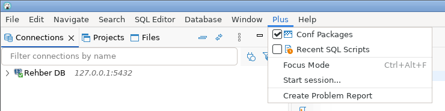

## Tabloda FK açıklamaları

Başka bir tabloya bağlı (FK) bir kolonda, ID'nin yanında o kaydın adı da görünür: `2 Aktif`, `10 Web sitesi`. Hiçbir
şey ayarlamadan çalışır; açıklama soluk renkte yazılır, hücrenin değeri yine ID'dir.


**Açıklama olarak hangi kolon görünsün?** dbeaver-mm, referans tablodan `name`, `label`, `title` gibi bir kolonu
kendisi seçer. Başka bir kolon istersen:

1. FK kolonunun başlığındaki **⋯** düğmesine tıkla.
2. Açılan listeden kolonu seç (örneğin `code`).
3. Seçim bu bağlantı için kaydedilir; aynı tabloya giden her FK kolonu artık onu gösterir.

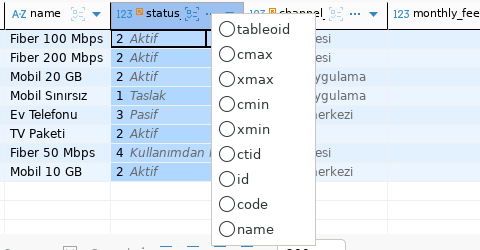

**Farklı bağlantılar arasında:** Referans tablo başka bir bağlantıdaysa (örneğin ayarlar ayrı bir veritabanında)
DBeaver'da *sanal FK* tanımlanabilir. Bu yoldan gelen açıklamalar **turkuaz** renkte yazılır, böylece verinin başka
veritabanından geldiği belli olur.

## Hücreden değer seçme

FK hücresine ID'yi ezbere yazmana gerek yok; referans tablodan adıyla arayıp seçebilirsin.

1. FK hücresine çift tıkla. Hücrenin sağında küçük bir **▾** okuyla düzenleme kutusu açılır.
2. **▾** okuna tıkla. Değer / Açıklama listesi ve arama kutusu açılır.
3. Adın bir kısmını yaz. Arama veritabanında yapılır; büyük/küçük harf ve Türkçe karakter farkı gözetilmez (`kullan`
   yazınca *Kullanımdan kalktı* bulunur).
4. Satıra tıkla ya da Enter'a bas. ID hücreye yazılır.
5. Değişikliği veritabanına yazmak için alttaki **Save**'e bas. Vazgeçmek için **Cancel**.


**Boş hücreler:** Değeri `[NULL]` olan hücrelerde de çalışır; eksik değeri buradan seçerek doldurabilirsin.

**Conf paketlerindeki satırlar:** Henüz veritabanına yazılmamış ama bir conf paketine eklenmiş satırlar, listenin en
üstünde `[conf <task id>]` işaretiyle görünür (bkz. [Conf paketleri](#conf-paketleri)).

## Filtre kutusunda adla filtreleme

Sonuç tablosunun üstündeki filtre kutusunda ID yerine adı yazarak filtreleyebilirsin.

1. Filtre kutusuna tıkla ve `kolon = ` yaz (eşittirden sonra bir boşluk). Örnek: `status_id = `
2. Değerler açıklamalarıyla listelenir. Adın bir kısmını yaz (`akt`); liste daralır.
3. Enter ile seç. Kutuya ID yazılır (`status_id = 2`).
4. Tekrar Enter: filtre uygulanır.

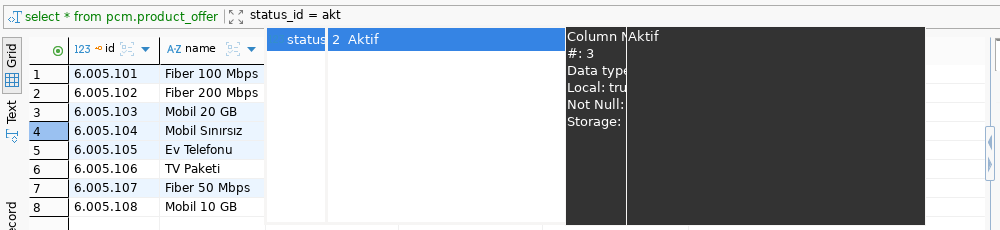

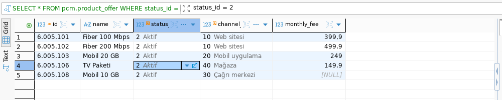

İpuçları:

- `kolon IN (` yazınca da liste açılır; birden çok değer ekleyebilirsin.
- Arama veritabanında yapılır, yalnızca ekrandaki ilk satırlarda değil. Büyük/küçük harf ve Türkçe karakter farkı
  gözetilmez (`müşteri` araması `Musteri`'yi bulur).
- Aranan metinde boşluk varsa tırnak içinde yazabilirsin: `name = 'Fiber 1`.
- Listede yalnızca **şu anki sonuçta geçen** değerleri görmek için filtre araç çubuğundaki
  *Value list: only values in the result* düğmesini aç (üzerine gelince bu ipucu görünür).

## SQL editörü araçları

**WHERE'de değer seçici.** SQL yazarken bir FK kolonundan sonra `=` ya da `IN (` yazınca, referans tablonun değerleri
açıklamalarıyla listelenir. Yazdıkça daralır; seçtiğin değer imlecin olduğu yere eklenir (metinse tırnaklı, sayıysa
düz).

```sql
select * from pcm.product_offer
where channel_id =      -- burada liste açılır: 10 Web sitesi, 20 Mobil uygulama ...
```

**Parametre formu (Ctrl+Alt+P).** İmleç bir sorgunun içindeyken **Ctrl+Alt+P**'ye bas. Sorgudaki bütün
`kolon = değer` koşulları bir pencerede listelenir. Bir koşulu seç, *Deger* kutusuna yeni değeri yaz ya da *Ara*
kutusundan referans tablodan seç, sonra **Doldur**. Sorgu çalıştırılmaz, yalnızca metindeki değerler değişir.

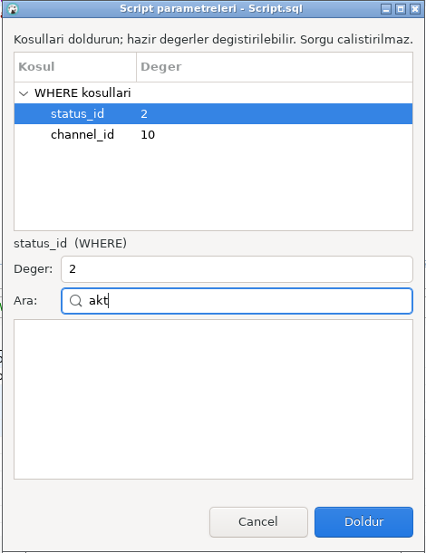

**Son SQL betikleri paneli.** *Plus › Recent SQL Scripts* sağda bir panel açar. Son açtığın 10 betik, içlerindeki
SQL'in başıyla kart olarak listelenir; karta tıklayınca betik açılır. Kartın sağındaki ☆ ile favoriye eklediğin
betikler hep en üstte durur.

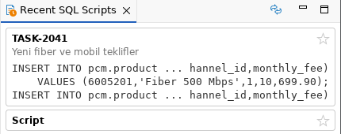

**Çok bağlantılı çalışma.** Editörün üstündeki *Connections* düğmesi, betiğin hangi bağlantılarda çalışabileceğini
seçer. Sorguda yazdığın tablo hangi bağlantıdaysa editör ona kendisi geçer. Bir bağlantıya kısa kod verdiysen,
`KOD.` yazınca yalnızca o bağlantının tabloları listelenir.

## Yeni satırlara ID getirme

Yeni satır eklerken anahtar (ID) değerini ID API'sinden almak için kullanılır. Tek seferde, eklediğin tüm boş ID'li
satırlar için ID alınır.

**Bir kerelik kurulum.** API dosyasını (`id-api.properties`) sana veren kişiden al ve `dbeaver` klasörüne,
`dbeaver.exe`'nin yanına koy. Sonra *Plus Settings › ID API account...* ile yalnızca kendi kullanıcı adını ve
şifreni gir. Dosyayı oraya koyamıyorsan aynı penceredeki **Import...** ile seç.

**Kullanım.**

1. Tabloyu aç, alttaki **Add row** (veya Alt+Insert) ile istediğin kadar yeni satır ekle. ID hücrelerini boş bırak.
2. Tabloda sağ tık › **Edit › Fetch IDs for new rows (n)**. Parantezdeki sayı, ID alınacak satır sayısıdır.

   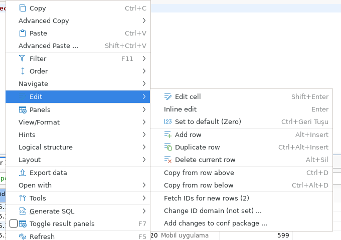

3. İlk kullanımda bağlantının hangi ID domain'ini kullandığı sorulur. Seçim bu bağlantı için saklanır; değiştirmek
   için *Edit › Change ID domain ...*.

   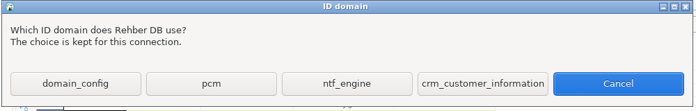

4. ID'ler yeni satırlara yazılır ve altta "n IDs filled" görünür. Satırlar veritabanına kaydedilmez; kalan alanları
   doldurup ya **Save** ile kaydedersin ya da bir conf paketine eklersin.

   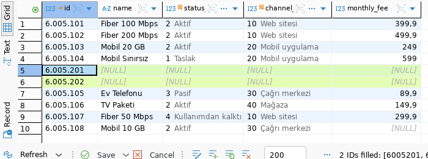

## Conf paketleri

Conf paketi, bir task için yaptığın veri değişikliklerini veritabanına yazmadan bir SQL dosyasında toplar. Dosya
`Scripts/conf/<task id>.sql` olarak kaydedilir; ilk satırı task açıklamasıdır. Bitince betiği kopyalayıp ilgili yere
yapıştırırsın.

**Pakete ekleme.**

1. Tabloda satır ekle, değiştir veya sil (henüz **Save**'e basma).
2. Sağ tık › **Edit › Add changes to conf package ...**
3. *Task ID* ve *Description* gir. Daha önceki task'lar açılır listede durur.
4. *Discard the changes in the grid afterwards* işaretli kalırsa tablodaki değişiklikler eklendikten sonra geri
   alınır; veritabanına hiçbir şey yazılmaz.
5. **OK**. Altta "n statements added to TASK-….sql" görünür.

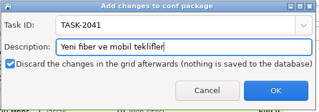

**Conf Packages paneli** (*Plus › Conf Packages*). Solda paketler en yeni üstte listelenir. Birini seçince sağda:

- **Rows** sekmesi: paketin her tablosu için satırlar ızgara olarak. FK kolonları `değer | etiket` gösterir.
- **SQL** sekmesi: paketin tüm betiği.
- **Copy <şema>** düğmeleri: o şemanın betiğini panoya alır; birden çok şema varsa *Copy all* de çıkar. Kopyalanan
  betik FK hatası vermeyecek sırayla dizilir (önce üst satırlar).

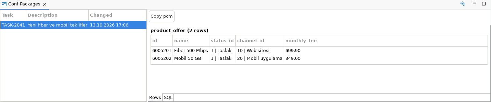

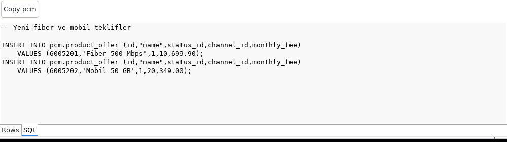

**Paneldeki diğer işlemler.**

- Hücreye çift tıkla: değeri yerinde düzenle; Enter yazar (boş için `NULL`), Esc vazgeçer.
- Sağ tık ya da Ctrl+C: hücre değerini kopyalar; *Copy row* bütün satırı.
- Sağ tık › *Delete row ...*: satırı pakette siler. Pencere, ona bağlı alt satırları da gösterir; seviyeyi seçip
  onlarla birlikte silebilirsin. Silinecekler kırmızı, onlara bağlı kalanlar turuncu görünür.
- Bir satırın FK değeri, aynı paketteki gösterdiği satırla aynı arka plan rengini alır.

## Oturum kaydı ve sorun raporu

**Sürekli kayıt.** dbeaver-mm; tablo açma, filtreleme, DML/DDL, conf paketi değişiklikleri ve ID getirme adımlarını
her zaman `.dbeaver-mm\kayit\surekli.jsonl` dosyasına yazar (2 MB'ta döner). Değerler maskelenmez, girdiğin veriler
de kayda geçer. Hiçbir şey dışarı gönderilmez.

**İsimli oturum.** Bir işin bütün adımlarını ayrı bir dosyada kaydetmek için:

1. *Plus › Start session...*
2. Bir isim yaz (task id ya da yapacağın iş) › **OK**.
3. Sol altta kırmızı **REC** etiketi görünür; kayıt sürüyor demektir.
4. İşin bitince *Plus › Stop session (…)*. Dosyanın kaydedildiği yer bir pencerede gösterilir.

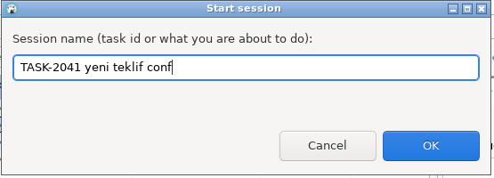


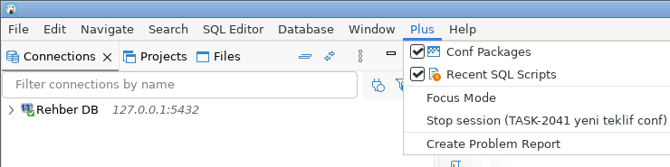

**Donma kaydı.** Pencere 1 saniyeden uzun cevap vermezse süresi ve nerede takıldığı `.dbeaver-mm\donma.log`
dosyasına yazılır; 2 saniye ve üstünde bildirim de çıkar (*Preferences › User Interface › Notifications › UI freeze*
ile kapatılır). Uzun süren arka plan işleri sağ altta *Working: …* etiketiyle görünür; bu bir donma değildir.

**Sorun raporu.** Bir hata ya da donma olursa *Plus › Create Problem Report*. Sürüm bilgisi, donma kaydı ve son
oturumların hata log'ları masaüstüne `dbeaver-mm-report-<tarih>.zip` olarak konur. Bu zip'i sorunu inceleyecek
kişiye gönder. Rapor SQL metni, tablo adları ve sunucu adresleri içerebilir; kendiliğinden hiçbir yere gönderilmez.

## Sorun giderme

| Belirti | Ne yapmalı |
| --- | --- |
| "Windows bilgisayarınızı korudu" | **Ek bilgi › Yine de çalıştır**. Dosya imzasız olduğu için normaldir. |
| FK hücresinde açıklama görünmüyor | Kolonun gerçekten bir FK (ya da sanal FK) olduğundan emin ol. Açıklama kolonunu başlıktaki **⋯** ile seç. |
| *Fetch IDs*: `isn't set up` | `id-api.properties` dosyası `dbeaver.exe`'nin yanında değil. Dosyayı veren kişiye sor ya da *Plus Settings › ID API account... › Import...* ile seç. |
| *Fetch IDs*: `Login failed` | Kullanıcı adı ya da şifre yanlış: *Plus Settings › ID API account...* ile yeniden gir. |
| *Fetch IDs* menüde soluk | Tabloda boş ID'li yeni satır yok ya da tablonun tek kolonlu bir anahtarı yok. |
| DBeaver bir süre cevap vermiyor | Sağ altta *Working: …* varsa iş sürüyor, bekle. Tekrarlıyorsa *Plus › Create Problem Report* ile zip'i gönder. |
| Yeni sürüme geçmek | Yeni zip'i ayrı bir klasöre çıkar ve oradan aç. Bağlantılar ve ayarlar `%APPDATA%\DBeaverData`'da, conf paketleri ve kayıtlar `.dbeaver-mm`'de kalır. |
